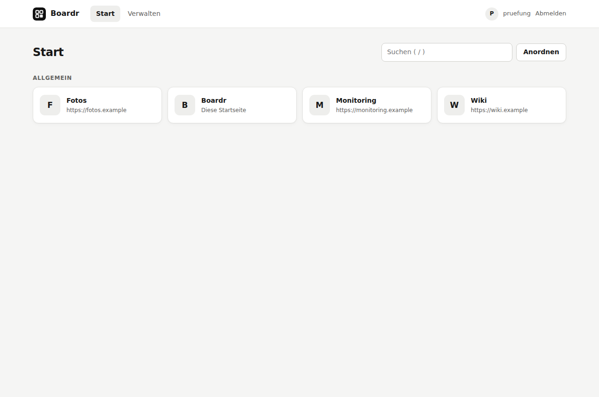

<p align="center"></p>
<h1 align="center">Boardr</h1>
<p align="center">Startseite fürs Homelab: Dienste als Kacheln, mit Status, Widgets und Suche.</p>



## Was es kann

| Bereich | Funktionen |
|---|---|
| Boards | mehrere Boards als Reiter, Gruppen, sichtbar für alle oder nur für bestimmte Gruppen |
| Anordnen | ziehen oder mit den Pfeiltasten schieben, auch zwischen Gruppen |
| Status | HTTP, `tcp://host:port`, `ping://host`, Antwortzeit, Verfügbarkeit über 24 Stunden |
| Suche | Taste `/`, über alle sichtbaren Boards, auf Wunsch direkt in Diensten |
| Widgets | Proxmox, Prometheus, Pi-hole 6, Home Assistant, Wetter, Kalender |
| Übernahme | Boards, Abschnitte und App-Kacheln aus Homarrs `db.sqlite` |

## Starten

```bash
cp .env.beispiel .env            # Kennwort für die Datenbank eintragen
docker compose up -d --build
docker compose logs boardr       # Link mit Einrichtungscode
```

Boardr läuft unter `http://<host>:8390`. Das erste Konto aus dem Link verwaltet
die App. Wer nur OIDC benutzt, trägt den Admin in `BOARDR_ADMIN` ein.

## Widgets mit Geheimnis

Tokens stehen in der `.env`, nie in der Datenbank. Im Widget steht nur der Name:

```bash
BOARDR_WIDGET_PVE=benutzer@pve!boardr=...
BOARDR_WIDGET_PVE_ZIEL=https://pve.example:8006
```

`_ZIEL` ist Pflicht und der einzige Host, der das Token bekommt. Das Wetter
kommt von open-meteo.com, dorthin geht die auf zwei Stellen gerundete Position.

## Boards je Gruppe

Beim Board stehen die Gruppen mit Komma. Verglichen wird mit dem Claim `groups`
des Anbieters. Keycloak schickt ihn erst mit einem Mapper "Group Membership" am
Client. Admins sehen alle Boards.

## Grenzen

* Kalender zeigen einzelne Termine, keine Serien.
* Ping geht über IPv4 und braucht `net.ipv4.ping_group_range` (in Docker gesetzt).
* Symbole brauchen https, hochgeladene Homarr-Bilder werden zum Buchstaben.

## Entwickeln

```bash
go run .
go test ./...
# mit Datenbank; sie wird geleert, der Name muss mit pruef beginnen
BOARDR_TEST_DB=postgres://.../pruef_boardr go test ./...
```

Go 1.27.4, PostgreSQL 17. Das Schema steht in `schema.sql`.

## Lizenz

MIT, siehe [LICENSE](LICENSE).
